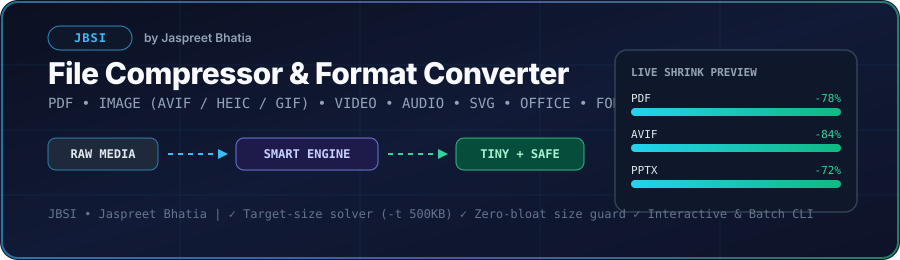
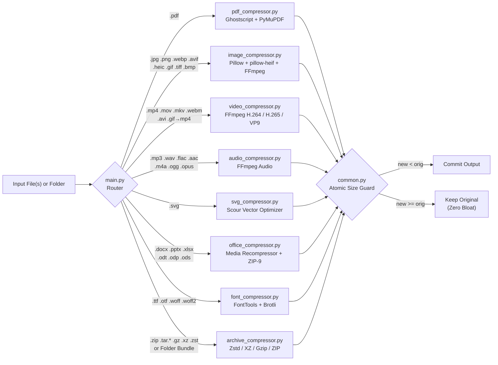
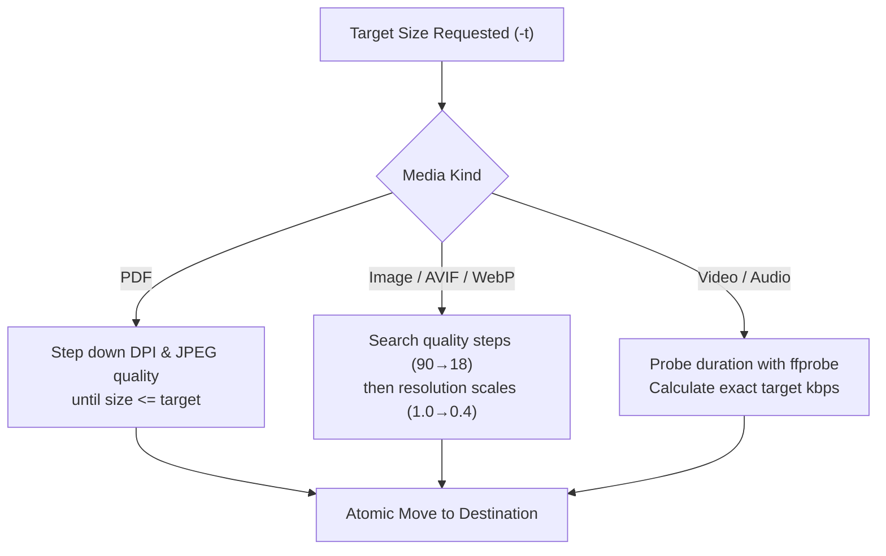

<div align="center">



<br/><br/>

# JBSI All-in-One Compressor

**Built by [Jaspreet Bhatia](https://github.com/Jaspreet-Bhatia-SI) (`JBSI`) — one modular Python CLI to shrink PDFs, images (AVIF / HEIC / WebP / GIF), videos, audio, SVGs, Office decks/docs, web fonts, and archives with automatic target-size fitting and zero-bloat guarantees.**

[](https://github.com/Jaspreet-Bhatia-SI)
[](https://github.com/Jaspreet-Bhatia-SI)
[](https://www.python.org/)
[](#supported-formats--engines)
[](LICENSE)

</div>

---

## Live Preview

<div align="center">
  
</div>

---

## Architecture & Pipeline

Every input passes through `main.py`, routes automatically to its dedicated compressor module, runs through the **Target-Size Solver** (when `-t` is set), and commits via the **Atomic Size Guard** so originals are never corrupted or accidentally enlarged.



### Target-Size Solver (`-t 500KB`, `-t 5MB`)



---

## Supported Formats & Engines

| Module | Input Formats | Output / Conversion | Engine |
| :--- | :--- | :--- | :--- |
| [`pdf_compressor.py`](pdf_compressor.py) | `.pdf` | `.pdf` | Ghostscript (`gs`) + PyMuPDF fallback |
| [`image_compressor.py`](image_compressor.py) | `.jpg` `.jpeg` `.png` `.webp` `.avif` `.heic` `.heif` `.gif` `.bmp` `.tiff` | `.jpg` `.png` `.webp` `.avif` `.heic` `.gif` | Pillow + `pillow-heif` + FFmpeg palettegen (GIF) |
| [`video_compressor.py`](video_compressor.py) | `.mp4` `.mov` `.mkv` `.avi` `.webm` `.m4v` `.flv` (+ `.gif` → video) | `.mp4` `.webm` (H.264 / H.265 / VP9) | FFmpeg |
| [`audio_compressor.py`](audio_compressor.py) | `.mp3` `.wav` `.flac` `.aac` `.m4a` `.ogg` `.opus` | `.mp3` `.aac` `.m4a` `.ogg` `.opus` | FFmpeg |
| [`svg_compressor.py`](svg_compressor.py) | `.svg` | `.svg` | Scour (metadata/comment/ID/path optimizer) |
| [`office_compressor.py`](office_compressor.py) | `.docx` `.pptx` `.xlsx` `.odt` `.odp` `.ods` | Same editable Office file, or `.pdf` via `-f pdf` | Embedded image downscaling + ZIP deflate-9 (+ LibreOffice) |
| [`font_compressor.py`](font_compressor.py) | `.ttf` `.otf` `.woff` `.woff2` | `.woff2` (default) / `.woff` | FontTools + Brotli |
| [`archive_compressor.py`](archive_compressor.py) | `.zip` `.tar` `.tar.gz` `.tgz` `.tar.bz2` `.tar.xz` `.tar.zst` `.gz` `.bz2` `.xz` `.zst` (+ folders) | `.zip` `.tar.gz` `.tar.bz2` `.tar.xz` `.tar.zst` `.gz` `.bz2` `.xz` `.zst` | Python `zipfile`/`tarfile`/`lzma` + `zstandard` |

---

## Project Structure

```text
compressor/
├── main.py                 # Unified CLI, interactive wizard, progress bar & Rich summary
├── common.py               # Shared types, size parser/formatter, ffprobe, atomic size guard
├── pdf_compressor.py       # Ghostscript + PyMuPDF compressor
├── image_compressor.py     # Pillow, AVIF, HEIC/HEIF & animated GIF compressor
├── video_compressor.py     # FFmpeg H.264 / H.265 / VP9 compressor
├── audio_compressor.py     # FFmpeg audio compressor & converter
├── svg_compressor.py       # Scour SVG vector minifier
├── office_compressor.py    # Editable Office media optimizer & PDF exporter
├── font_compressor.py      # TTF/OTF -> WOFF2 Brotli font compressor
├── archive_compressor.py   # Archive re-compressor & folder bundler
├── LICENSE                 # MIT License & JBSI Trademark Notice
├── requirements.txt        # Python dependencies
└── assets/                 # Animated SVG banner & terminal demo
```

---

## Setup

```bash
git clone https://github.com/Jaspreet-Bhatia-SI/compressor.git
cd compressor
python3 -m venv venv
source venv/bin/activate
pip install -r requirements.txt
```

> **Optional system binaries:**
> - **FFmpeg** (`ffmpeg`, `ffprobe`) — required for video, audio, and palette-optimized animated GIFs.
> - **Ghostscript** (`gs`) — recommended for high-ratio PDF compression (falls back to PyMuPDF if absent).
> - **LibreOffice** (`soffice`) — only needed when converting Office files directly to PDF via `-f pdf`.

---

## Usage Examples

```bash
# Interactive wizard (prompts for file/folder, preset, target size, output mode)
python main.py

# PDF: shrink under 2 MB
python main.py syllabus.pdf -t 2MB

# Images: convert iPhone HEIC or JPEG photo to modern AVIF / WebP
python main.py photo.heic -p medium -f avif
python main.py photo.jpg -p high -f webp

# Animated GIF: shrink GIF or convert GIF -> lightweight MP4
python main.py animation.gif -p medium --max-width 640
python main.py animation.gif -f mp4

# Video: resize to 720p max height with H.265 or hit exact size limit
python main.py clip.mp4 --max-height 720 --video-codec h265
python main.py clip.mp4 -t 10MB

# Audio: convert lossless WAV/FLAC to compact 64kbps MP3
python main.py recording.wav -p high

# SVG, Office Decks & Web Fonts
python main.py logo.svg -p high
python main.py presentation.pptx -p medium        # shrinks embedded slides/media, stays editable!
python main.py Inter-Regular.ttf                  # converts to Inter-Regular_compressed.woff2

# Archives & Folder Bundling
python main.py backup.zip -f tar.zst -p high      # re-pack ZIP as ultra-tight Zstd archive
python main.py ./assets_folder -f tar.zst         # bundle & compress entire folder

# Batch compress a folder recursively into ./out/
python main.py ./media -r --type image -f avif -o ./out/
```

<details>
<summary><strong>CLI Options & Preset Reference</strong></summary>

| Flag | Default | Description |
| :--- | :--- | :--- |
| `-p, --preset` | `medium` | `low` (highest quality), `medium` (balanced), `high` (smallest file) |
| `-q, --quality` | auto | Custom quality `1–100` for images, PDFs, and Office embedded media |
| `--dpi` | auto | Custom PDF image DPI (`36–600`) |
| `--max-width` / `--max-height` | none | Downscale images, videos, GIFs, or Office embedded images preserving aspect ratio |
| `-f, --format` | `keep` | Convert format (`avif`, `webp`, `heic`, `jpg`, `png`, `gif`, `mp4`, `webm`, `mp3`, `aac`, `m4a`, `ogg`, `opus`, `pdf`, `woff2`, `woff`, `zip`, `tar.gz`, `tar.xz`, `tar.zst`, `gz`, `xz`, `zst`) |
| `--video-codec` | `h264` | `h264` or `h265` for video |
| `--audio-bitrate` | auto | Audio bitrate in kbps (`24–320`) |
| `-t, --target-size` | none | Auto-fit output under size target (`500KB`, `5MB`, etc.) |
| `--type` | `all` | Filter folder scans: `all`, `pdf`, `image`, `video`, `audio`, `svg`, `office`, `font`, `archive` |
| `-o, --output` | `*_compressed` | Custom output file or directory |
| `--in-place` | `false` | Safely replace original file(s) atomically |
| `-r, --recursive` | `false` | Recurse into subdirectories |
| `--allow-larger` | `false` | Disable size-guard and keep output even if larger than source |

</details>

---

<div align="center">

**JBSI** — Designed & Built by **[Jaspreet Bhatia](https://github.com/Jaspreet-Bhatia-SI)**

*Copyright &copy; 2026 Jaspreet Bhatia (`JBSI`). Licensed under the [MIT License](LICENSE).*

</div>
